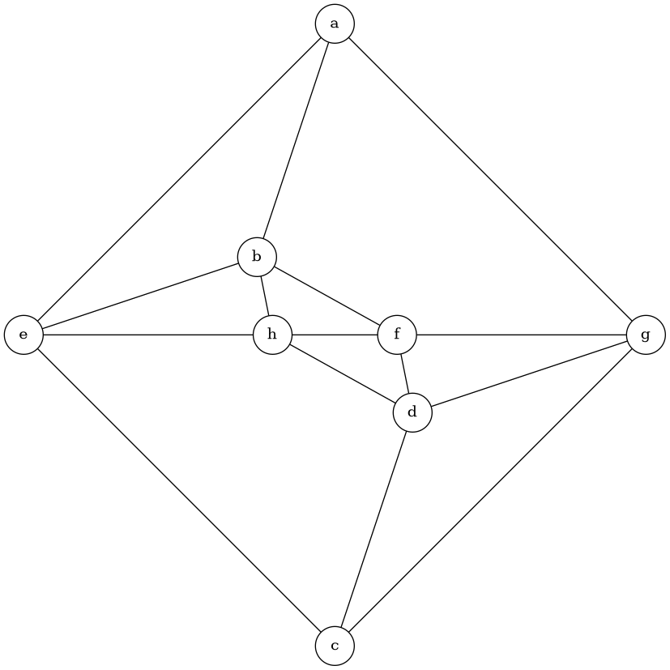

# Задание 6: проверка планарности и плоская укладка графа

- проверка планарности и комбинаторная укладка (список граней): алгоритм Демукрона
- геометрическая укладка: алгоритм Тутте, вершины внешней грани ставятся на правильный многоугольник, каждая внутренняя вершина ставится в центр масс своих соседей

Если граф планарен, укладка с координатами вершин записывается в DOT

## Файлы

| Файл           | Описание                                      |
| -------------- | --------------------------------------------- |
| `planarity.py` | программа (Демукрон, Тутте и экспорт в DOT)   |
| `planar.txt`   | пример планарного графа                       |
| `planar.dot`   | результат экспорта                            |
| `planar.png`   | визуализация через Graphviz                   |
| `petersen.txt` | пример непланарного графа (граф Петерсена)    |

## Формат входного файла

Одно ребро в строке: `вершина вершина`

## Запуск

```
python3 planarity.py planar.txt
dot -Tpng planar.dot -o planar.png
```

Алгоритм Демукрона работает с двусвязными графами, программа сначала проверяет двусвязность.
В DOT-файле указан `layout=neato`, поэтому Graphviz ставит вершины по координатам, которые посчитал алгоритм Тутте, а не расставляет их сам

## Пример работы

### Планарный граф

```
Граф планарен
Грани (9):
  e b a
  a e c g
  b a g f
  e b h
  h b f
  d f g
  g c d
  d c e h
  h f d
Координаты вершин:
  a: (0, 4)
  b: (-1, 1)
  c: (0, -4)
  d: (1, -1)
  e: (-4, 0)
  f: (0.8, 0)
  g: (4, 0)
  h: (-0.8, 0)
```

В графе 8 вершин и 15 рёбер, граней 9, что сходится с формулой Эйлера $n - m + f = 2$.
Внешней гранью взята самая длинная грань `a e c g`



### Непланарный граф

```
python3 planarity.py petersen.txt
```

```
Граф не планарен
```

По числу рёбер граф Петерсена не отсеивается: $m = 15 \le 3n - 6 = 24$. Но он содержит подграф,
гомеоморфный $K_{3,3}$, и алгоритм Демукрона доходит до сегмента, который нельзя уложить ни в одну грань
